<div align="center">

<a href="docs/media/shelfos-film-45s.mp4">
  
</a>

<br>

# ShelfOS

### Every shelf. In sight.

From a ceiling camera to a to-do list a member of the store staff can act on.
For every planogram area, ShelfOS says whether the right product is there and how full it is.

<br>

[](https://www.python.org)
[](https://pytorch.org)
[](https://github.com/facebookresearch/dinov3)
[](https://fastapi.tiangolo.com)
[](https://nextjs.org)


<br>

**[▶ Watch with sound](docs/media/shelfos-film-45s.mp4)** &nbsp;·&nbsp;
**[Features](#-what-you-get)** &nbsp;·&nbsp;
**[Run it](#run-it)** &nbsp;·&nbsp;
**[How it works](#how-it-works)** &nbsp;·&nbsp;
**[Results](#labels-and-measured-results)** &nbsp;·&nbsp;
**[Rules](#rules-confirmed-by-the-organisers)**

</div>

<br>

<table>
<tr>
<td align="center" width="25%"><h2>14</h2><sub>fixed ceiling cameras</sub></td>
<td align="center" width="25%"><h2>152</h2><sub>planogram areas read per sweep</sub></td>
<td align="center" width="25%"><h2>1</h2><sub>batched forward pass per image</sub></td>
<td align="center" width="25%"><h2>0</h2><sub>fine-tuned weights: frozen DINOv3</sub></td>
</tr>
</table>

## ✨ What you get

Every clip below is a real screenshot of the running app; the film only moves a camera over them
(see [`pitch/film/`](pitch/film/README.md)). The numbers on screen are what the app showed at capture time,
not official evaluation results.

<table>
<tr>
<td width="50%" valign="top">
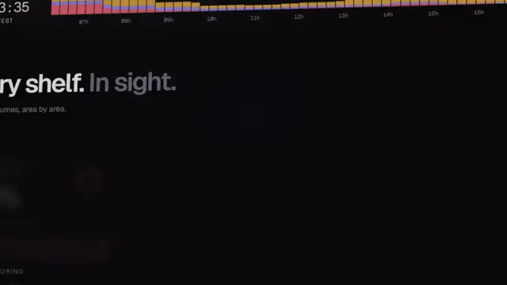
<h3>🧱 The store wall</h3>
Availability, live problems and compliance for the whole store at a glance, with every camera underneath.
</td>
<td width="50%" valign="top">
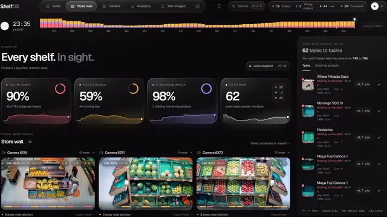
<h3>⏯️ Day replay</h3>
Scrub the store from 07:35 to 23:35 and watch the shelves sell down and get refilled.
</td>
</tr>
<tr>
<td width="50%" valign="top">
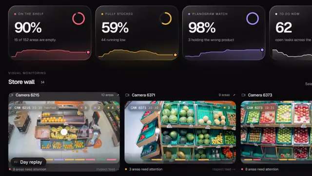
<h3>🎯 Planogram check</h3>
Open a camera, tap a slot, and see what ShelfOS sees as product, area by area.
</td>
<td width="50%" valign="top">
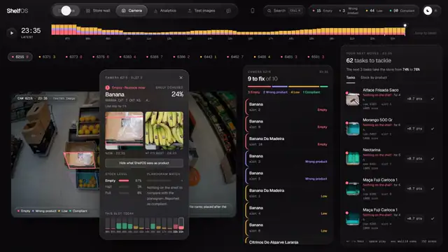
<h3>✅ Tasks</h3>
Problems become a to-do list. Tick one off and the store score moves.
</td>
</tr>
<tr>
<td width="50%" valign="top">
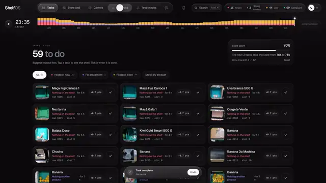
<h3>📈 The day, in numbers</h3>
Stock, compliance and coverage over the day, the hardest moment, and the typical time to fix.
</td>
<td width="50%" valign="top">
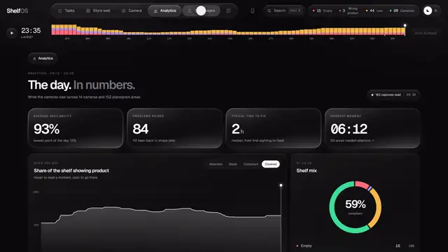
<h3>🧪 New images, clear answers</h3>
Drop a folder, loose files or a zip. Each image is answered as it finishes; download <code>predictions.json</code>.
</td>
</tr>
<tr>
<td width="50%" valign="top">
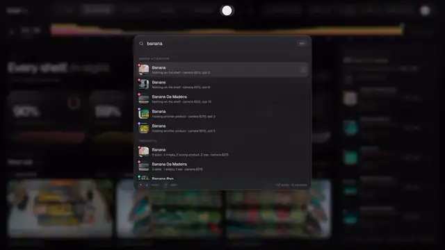
<h3>🤖 ShelfOS AI</h3>
Ask "What needs attention first?" and jump straight from the answer to the right camera and slot.
</td>
<td width="50%" valign="top">
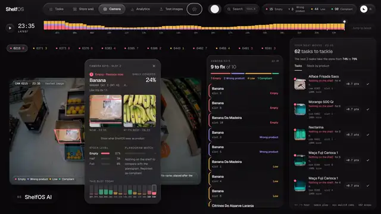
<h3>📱 Team mobile</h3>
A route through the store for the staff on the floor, at <code>/colaboradores</code>.
</td>
</tr>
<tr>
<td width="50%" valign="top">
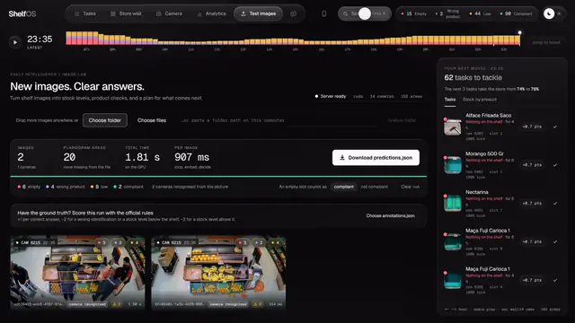
<h3>🔎 Search</h3>
Find any product across every camera and area.
</td>
<td width="50%" valign="top">
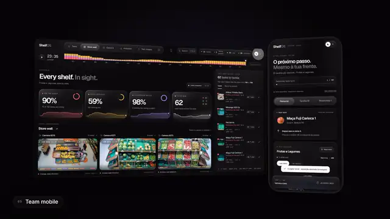
<h3>🌗 Light and dark</h3>
Both themes, on desktop and mobile.
</td>
</tr>
</table>

## 🧠 The pipeline

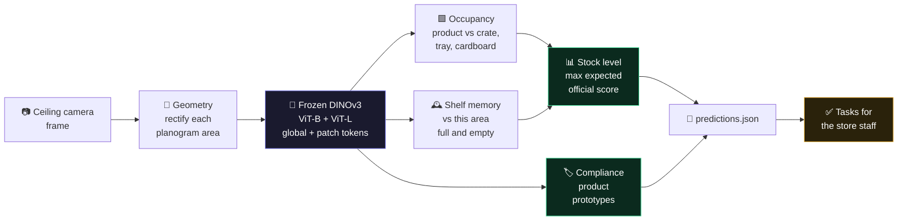

<br>

---

## Rules confirmed by the organisers

Read this before changing how an answer is decided or how an image is labelled. These
questions are closed; do not reopen them.

**An empty area is `planogram_compliant: true`.** The organisers answered this on
10 Oct 2026 (it was question Q3 in `docs/arquivo/STEP1_PLAN.md`). What we take from the answer:

- `planogram_compliant: false` is only for an area where a product other than the expected
  one is present.
- A missing product is recorded in the stock fields alone: `stock_level: "empty"`,
  `stock_value: 0`.
- When labelling, an empty area is compliant and needs no "unsure" mark. In the labelling
  guide (`docs/arquivo/STEP1_PLAN.md`, B3) the rule "empty area: compliant true, plus `u`" is now just
  "empty area: compliant true". Rule 10 in `labeler/docs/regras.md` says the same.

The code answers this way and has no switch for it: the command line, the server and the app
always report an empty area as compliant. The `--empty-noncompliant` option and the switch on
the results screen were removed on 11 Oct 2026.

**Evaluation images come with their timestamp, but the answer must come from the image.**
Asked whether the model may learn from earlier moments of the day, the organisers answered
on 10 Oct 2026 (question Q6): "You will get the timestamp but the model should learn from
the image itself and not necessarily the time of day." On Discord they also wrote: "You
should only consider information from the image under analysis." What we take from it:

- Each answer in `predictions.json` is read from its own image, never from earlier test
  captures: `Engine.ONLINE` (remember each predicted frame for the next one) stays `False`.
- The time-of-day prior (`Engine.HOUR_SCALE`, 0.5 today) is under review as a rules risk.
  See `AGENTS_COORDINATION.md`; Fable owns that change.
- The app may use the timestamps to order captures and look across the day, as the sell-down
  pace in `web/app/forecast.ts` does, as long as none of it reaches `predictions.json`.

## Run it

```
pip install -r requirements.txt
python run.py
```

This opens the app at http://localhost:8000 (on Windows you can also double-click `run.bat`).
The first start embeds the reference day and fits the model; that takes about a minute on a
GPU. It expects the challenge data in `data/images/<camera>/<timestamp>.jpg` and
`data/planogram.json`.

To test on new images, press **Test on new images** and drop a folder, loose files or a
zip (or paste a folder path). Each image is answered as it finishes; then download
`predictions.json`, which is in the official annotation format.

Without the interface:

```
python run.py --images <folder or zip> --out predictions.json
```

Useful switches: `--lan` makes the app reachable from a phone or tablet on the same
network, `--cpu` skips the GPU, `--train` rebuilds the model after the labels change.

To score a prediction file against an annotation file with the official rules, drop
`annotations.json` on the results screen, or:

```
python -c "import json,sys; from shelfos.scoring import score_submission as s; print(s(json.load(open(sys.argv[1])), json.load(open(sys.argv[2]))))" predictions.json annotations.json
```

**Count units.** In an area's detail, **Count units** boxes every unit of the expected product
the camera can see and says "≈ 9 items visible · 2 partly hidden". Units under the top layer
are not visible and are not guessed.
- How it counts: a vision model behind OpenRouter (`shelfos/counting.py`, the same
  `OPENROUTER_API_KEY` as the assistant), on demand only.
- It is separate from the engine. It uses no GPU and never touches `predictions.json`.
- It counts only the product groups that passed the hand-count test: `python tools/count_eval.py`
  against `labels/unit_counts.txt`, pass mark in `Plano.md`.
- `python tools/precount.py` caches the reference day, so the demo needs no network.

## What it does with awkward input

| Input | What happens |
| --- | --- |
| Images in `<camera>/<file>` folders | The folder names the camera. |
| Loose files, no folders | The camera is recognised from the picture itself (the cameras never move). |
| A zip, with or without a wrapping folder, with macOS `._` files | Opened in place, debris ignored. |
| Another resolution | Resized onto the planogram's pixel grid, with a warning. |
| Greyscale, PNG, alpha channel | Converted and analysed. |
| A file that cannot be decoded | Every area is still answered, from its last known state, and flagged. A missing area would cost 5 points. |
| An image filed under the wrong camera | Kept under the folder it came in, with a warning naming the camera it looks like. |
| Areas partly outside the frame (negative coordinates) | The part outside is masked, not read as empty shelf. |

`python tools/selftest.py` runs these cases.

## How it works

1. **Geometry.** Each planogram quadrilateral is perspective-rectified to a square crop.
2. **Features.** Frozen DINOv3 backbones (ViT-B/16 + ViT-L/16, features concatenated; the
   light engine uses ViT-B alone) give one global embedding and a 14x14 grid of patch tokens
   per crop, averaged over the crop and its mirror image. No fine-tuning. One image (about
   12 areas) is one batched forward pass.
3. **Occupancy.** A patch classifier separates product from background (crate, tray,
   cardboard, basket) and gives the share of the area that is covered.
4. **Shelf memory.** The cameras are fixed, so the crops of one area line up patch for patch
   over time. Each new crop is compared with what the same area looked like when it was
   full and when it was empty. This is what makes late-evening frames work: it measures
   how much has changed without needing to know the product.
5. **Stock level.** Logistic regression on embedding, occupancy and memory features. The
   level reported is the one with the highest expected official score (+1 / -2 below /
   -3 above), so a borderline shelf is called half rather than full.
6. **Compliance.** Each product has a prototype embedding. A crop is compared with the
   expected product, with all other products, and with the area's own history. The app
   also names the product the area looks like when it is not the expected one.

## Labels and measured results

The dataset ships without annotations. `labels/silver_labels.txt` holds our own labels for
the reference day: a first pass made by eye from image strips, then corrected by a person
with the labelling tool below. They are not the official ground truth, and the half/full
boundary in particular is a judgement call. The official score on the hidden validation set
is unknown until the organisers run it.

Cross-validation of the engine against those labels, last measured on the afternoon of
10 Oct 2026. The model code has kept changing since, so for current numbers rerun
`python tools/cv.py --split late` and `python tools/cv.py --split fwd`.

| Held out | Areas | Stock level correct | Product answer correct | Share of the maximum score |
| --- | --- | --- | --- | --- |
| The last two frames of every camera | 304 | 91.8% | 99.0% | 82.9% |
| Each later part of the day, after training on the earlier part | 1216 | 94.1% | 99.7% | 88.4% |

The share of the maximum is lower than the two accuracies because a wrong answer costs
points (-2 or -3) on top of the point it does not earn. Most stock errors overestimate the
level: 20 of the 25 in the first row.

Same split, step by step (points per area out of a maximum of 2, stock + product):

| Engine | Stock pts | Product pts | Over / under |
| --- | --- | --- | --- |
| ViT-B, no shelf-novelty feature | +0.635 | +0.970 | 24 / 5 |
| + novelty feature and obstruction guard | +0.661 | +0.970 | 22 / 5 |
| + mirror test-time augmentation (`engine_lite.pkl`) | +0.661 | +0.980 | 22 / 5 |
| + ViT-L in ensemble (`engine.pkl`, shipped) | +0.688 | +0.970 | 20 / 5 |

Tried and dropped because they did not measure better on both splits: 448 px crops,
blending in a nearest-neighbour vote, temperature scaling, and a fixed shift of the decision
towards the lower level (it gains on the last-frames split and loses the same on the
forward split, so it is noise; the expected-score rule already leans low).

### Labelling tool

Labels are reviewed by hand with the standalone tool in `labeler/` (no dependencies; see
`labeler/README.md`). It writes reviewed areas back into `labels/silver_labels.txt` with
`python3 labeler/app.py --apply <names>`. Then run `python run.py --train` so the model
is rebuilt from the new labels.

## Open question for the organisers

Are self-made labels on the train set allowed?

Whether an empty area is compliant is no longer open: see "Rules confirmed by the
organisers" at the top.

## Layout

```
run.py              one command: the app, or predictions for a folder
shelfos/            engine (features, occupancy, memory, compliance, scoring), service, server
web/                the interface (Next.js, exported to static files and served by run.py)
tools/cv.py         cross-validation of the shipped engine against our labels
tools/selftest.py   edge-case drill
labeler/            label review tool (standalone, see labeler/README.md)
labels/             our labels for the reference day
edgecase_labeler/   label tool for the AI-generated edge cases
ai_generated_edgecases/  synthetic stress tests and their reviewed labels
pitch/film/         demo film generator: edit, renderer, soundtrack, screenshots (see pitch/film/README.md)
Plano.md            current plan: the four UI ideas
docs/DEPLOY.md      deploying the container (Hugging Face Spaces, Fly.io, ...)
docs/Sensei - JunctionX Lisbon 2026.txt   the challenge brief
docs/arquivo/       superseded documents, kept for reference
```

<br>

<div align="center">

<a href="docs/media/shelfos-film-45s.mp4">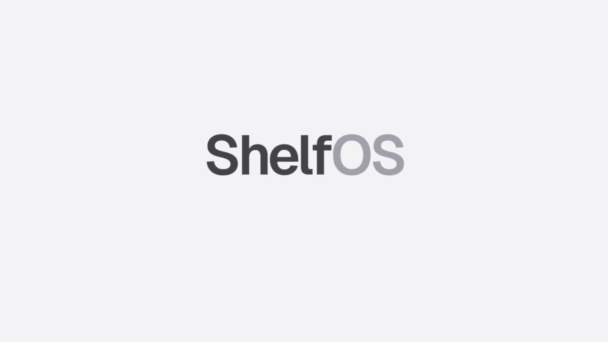</a>

<sub>The film is rendered frame by frame from <a href="pitch/film/film45.html"><code>pitch/film/film45.html</code></a>, with a soundtrack synthesised by <a href="pitch/film/audio45.py"><code>audio45.py</code></a>. No third-party music, nothing in the UI redrawn.</sub>

</div>
